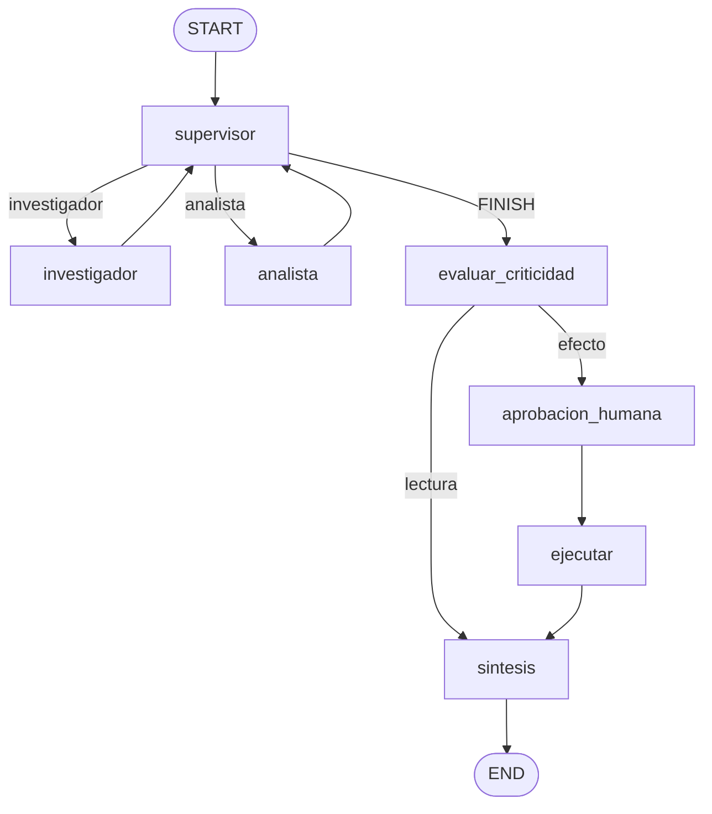
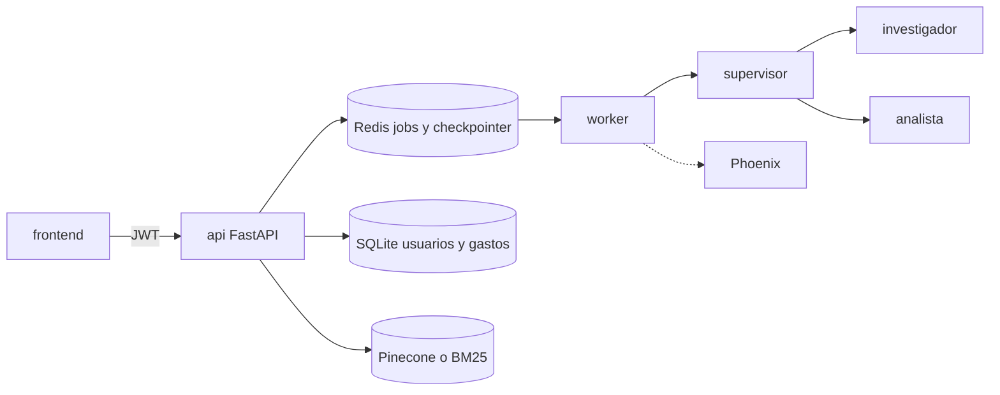

# Gastos del hogar

Sistema de IA para registrar comprobantes de un hogar y preguntar por ellos. Una persona carga una factura, confirma el monto y consulta en el chat. Quien no pertenece a ese hogar no ve esos datos.

El libro de montos está en SQLite. El texto de las facturas está en un índice (Pinecone o, si no responde, BM25). No se mezclan: un total sale de SQL; una pregunta sobre qué dice una factura sale del índice.

Este repositorio es la entrega final del programa. La rúbrica oficial y el orden de revisión para un agente están en [`docs/evaluacion.md`](docs/evaluacion.md). El contrato de producto, que manda sobre los planes, está en [`FUENTE-DE-LA-VERDAD.md`](FUENTE-DE-LA-VERDAD.md).

## Qué integra

| Capa | Dónde | Qué hace |
| --- | --- | --- |
| API | FastAPI, `api/app/main.py` | Auth, comprobantes, resumen y consultas. `POST /tasks` responde 202 y no espera al modelo. |
| Cola y memoria | Redis 8 | Jobs y checkpointer de LangGraph (`RedisSaver`). |
| Agentes | `api/app/graph.py` | Un supervisor delega en un investigador y un analista. No se hablan entre sí. |
| RAG | `api/app/rag.py` | Búsqueda híbrida. El `user_id` y el hogar los pone el sistema, no el modelo. |
| Trazas | Arize Phoenix | Proyecto `gastos-hogar`. LangSmith queda disponible si hay clave. |
| Interfaz | `frontend/` | SPA. El navegador solo habla HTTP con la API. |

Login, hogares, gráficos y lectura de fotos están encima de esas piezas. La rúbrica no los pide y no los penaliza.

## Cómo levantarlo

Hace falta Docker. Para la carga de prueba, Python 3.12.

Los secretos, el nombre del índice y el nombre del modelo viven solo en `api/.env`. No están en este repositorio.

```bash
cp api/.env.example api/.env
```

Completar ahí, con valores propios:

- `JWT_SECRET`
- `LLM_PROVIDER` (`openai` o `gemini`)
- `OPENAI_API_KEY` y `OPENAI_MODEL`, o `GOOGLE_API_KEY` y `GEMINI_MODEL`

`PINECONE_API_KEY`, `INDEX_NAME` y `EMBEDDING_MODEL` son opcionales. Si Pinecone no responde, la búsqueda sigue en BM25. El modelo de embeddings, si se usa, tiene que ser de 384 dimensiones.

Un solo comando, desde la raíz de este repositorio:

```bash
./run.sh
```

Eso ejecuta `docker compose up -d --build` y espera a Phoenix y a `GET /health`.

| Servicio | Dónde | Para qué |
| --- | --- | --- |
| Redis 8 | `localhost:6379` | Cola de jobs y checkpointer |
| Phoenix | http://localhost:6006 | Trazas. Proyecto `gastos-hogar` |
| API | http://localhost:8000/docs | FastAPI. El worker corre en el mismo proceso |
| Frontend | http://localhost:5173 | SPA. Llama a `http://localhost:8000` |

Si el 6379 o el 6006 ya están ocupados, `./run.sh` publica el siguiente puerto libre y lo imprime. Dentro de la red la API sigue usando `redis:6379` y `phoenix:6006`. La API y el frontend no se mueven: CORS y `VITE_API_URL` dependen de 8000 y 5173.

`GET /health` responde `{"status":"ok"}` cuando Redis contesta. El compose fija `FRONTEND_ORIGIN`, `REDIS_URL`, `PHOENIX_PROJECT=gastos-hogar` y el collector de Phoenix. Esas variables pisan las del `.env` porque, dentro del contenedor, `localhost` no es el host.

`api/docker-compose.yml` es una copia de una pre-entrega. No levanta el frontend ni es el comando de esta entrega.

## Cómo probar las cinco consultas

Con la API en marcha y `api/.env` completo:

```bash
api/.venv/bin/python api/scripts/carga.py
```

Si el virtualenv no existe, crearlo con Python 3.12 dentro de `api/` (`python3.12 -m venv .venv` y `pip install -r requirements.txt`). El script no inventa trazas: sin `JWT_SECRET` no hay registro; sin la clave y el modelo, la lectura del PDF responde 502 y el job queda `FAILED`.

El script registra dos personas, confirma comprobantes por la API y hace cinco `POST /tasks` (responden 202):

1. Ada pregunta cuánto pagó de expensas en marzo. Analista y libro SQL.
2. Ada compara la luz de enero contra febrero. Analista y calculadora.
3. Ada pregunta qué dice la factura de alquiler sobre el ajuste. Investigador e índice.
4. Bea pregunta cuánto pagó de expensas en marzo. Es el libro de Bea.
5. Bea pregunta por el texto del alquiler. No es el comprobante de Ada.

También comprueba que el resumen de una persona no incluye los montos de la otra y que un `GET /documentos/{id}` cruzado responde 404.

En Phoenix (proyecto `gastos-hogar`) cada consulta es una traza. Ahí aparecen el supervisor, el investigador, el analista, el span `ejecutar_tarea` y las llamadas al modelo como `ChatConCanal`. Las imágenes de `screenshots/` no reemplazan esa corrida. La carpeta `api/screenshots/` no trae capturas de esta entrega. La evidencia es Phoenix, proyecto `gastos-hogar`, y lo que quede en `screenshots/` después de la corrida.

## Grafo de agentes

El supervisor elige un especialista. El investigador y el analista vuelven al supervisor. `FINISH` pasa por `evaluar_criticidad`. Una consulta de lectura sigue a la síntesis. Una acción con efecto (asentar un pago) queda en `AWAITING_APPROVAL` hasta `POST /tasks/{id}/approve`.



El investigador usa `buscar_comprobantes` sobre el retriever híbrido. El analista usa `consultar_gastos` (agregados SQL) y la calculadora, que recorre un árbol de expresiones y no llama a `eval`. Los argumentos de las tres tools son modelos Pydantic. Ninguno acepta `user_id`.

El grafo se compila en `construir_grafo` con el checkpointer de Redis. El hilo de la conversación es `thread_id`: al reiniciar el servidor, el checkpoint sigue en Redis.

## Del navegador a la traza



## Pruebas automáticas

Desde `api/`, con el virtualenv activo:

```bash
python -m pytest
```

Cubren el ruteo del supervisor, la pausa humana, la extracción, el aislamiento entre cuentas, los hogares y el contrato HTTP. No sustituyen las cinco trazas de Phoenix: esas salen de `api/scripts/carga.py` con el stack levantado.

## Configuración

La lista comentada está en [`api/.env.example`](api/.env.example). El código lee el nombre del modelo, el índice y las claves desde el entorno. No hay un modelo ni un índice escritos fijos en el código de la aplicación.

`OBSERVABILIDAD` acepta `phoenix` (el valor de esta entrega), `langsmith` o `both`. Phoenix no pide clave. LangSmith solo arranca si existe `LANGSMITH_API_KEY`.

## Mapa del repositorio

```
├── README.md                 # este archivo
├── AGENTS.md                 # por dónde entra un agente
├── FUENTE-DE-LA-VERDAD.md    # contrato de producto
├── docs/evaluacion.md        # protocolo para puntuar la entrega
├── docker-compose.yml
├── run.sh
├── api/                      # FastAPI, grafo, RAG, tests, script de las cinco consultas
├── frontend/                 # SPA
└── screenshots/              # capturas; la evidencia viva está en Phoenix
```

Los planes de implementación en `docs/plan-*.md` y los prompts en `prompts/` explican cómo se construyó. No reemplazan la rúbrica ni este README.
