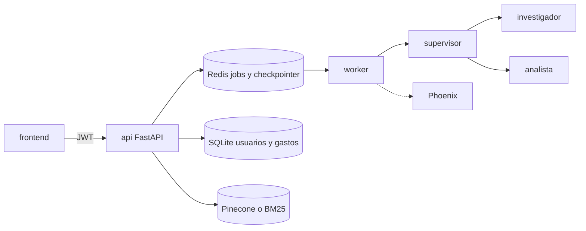

# Capstone

Asistente de gastos del hogar. Una persona carga comprobantes, confirma los montos y pregunta por sus gastos. Otra persona no ve esos datos. El contrato está en [`FUENTE-DE-LA-VERDAD.md`](FUENTE-DE-LA-VERDAD.md). Este archivo solo dice cómo levantar y probar. No lo reemplaza.

Los totales salen de SQL. El texto de las facturas sale del índice. No se mezclan.

- SQLite guarda usuarios, borradores y montos confirmados. El dashboard (`GET /resumen`) y el analista (`consultar_gastos`) suman ese libro.
- El índice (Pinecone o, si no responde, BM25) guarda el texto del comprobante y la metadata `user_id`, categoría, período y proveedor. Lo usa el investigador. Una pregunta sobre qué dice una factura no se responde solo con SQL.

## Cómo levantar

Hace falta Docker y, para la carga de prueba, el virtualenv de la API (Python 3.12).

Secretos, nombre de índice y nombre de modelo viven solo en `api/.env`. No están en este repositorio. Si el archivo no existe:

```bash
cd capstone
cp api/.env.example api/.env
```

Completar ahí, con valores propios:

- `JWT_SECRET`
- `LLM_PROVIDER` (`openai` o `gemini`)
- `OPENAI_API_KEY` y `OPENAI_MODEL`, o `GOOGLE_API_KEY` y `GEMINI_MODEL`

`PINECONE_API_KEY` e `INDEX_NAME` son opcionales. Si Pinecone no responde, la búsqueda sigue en BM25. No copiar `pre-entrega-7-api/.env`.

Un solo comando, desde `capstone/`:

```bash
./run.sh
```

Levanta cuatro servicios:

| Servicio | Dónde | Para qué |
| --- | --- | --- |
| Redis 8 | `localhost:6379` | Cola de jobs y checkpointer de LangGraph |
| Phoenix | http://localhost:6006 | Trazas. Proyecto `gastos-hogar` |
| API | http://localhost:8000/docs | FastAPI. El worker corre en el mismo proceso |
| Frontend | http://localhost:5173 | SPA. El navegador llama a `http://localhost:8000` |

Si el 6379 o el 6006 ya los usa otro proceso, `./run.sh` publica el siguiente puerto libre y lo imprime. Adentro de la red la API sigue usando `redis:6379` y `phoenix:6006`. El frontend y la API no se mueven: CORS y `VITE_API_URL` dependen de 5173 y 8000.

`GET /health` responde `{"status":"ok"}` cuando Redis contesta. El compose fija `FRONTEND_ORIGIN=http://localhost:5173`, `REDIS_URL` y el collector de Phoenix en la red de Docker. Esas variables pisan las del `.env` porque dentro del contenedor `localhost` no es el host.

El `docker-compose.yml` que está en `api/` es el de la copia de la pre-entrega: no levanta el frontend ni la API por defecto. El comando de esta entrega es `./run.sh` en esta carpeta.

## Cómo probar

Con la API ya en marcha y el `.env` completo:

```bash
api/.venv/bin/python api/scripts/carga.py
```

El script registra dos personas, confirma comprobantes por la API y hace cinco `POST /tasks` (responden 202, sin esperar al modelo):

1. Ada pregunta cuánto pagó de expensas en marzo. Tiene que ir al analista y al libro SQL.
2. Ada compara la luz de enero contra febrero. Analista y calculadora.
3. Ada pregunta qué dice la factura de alquiler sobre el ajuste. Tiene que ir al investigador y al índice.
4. Bea pregunta cuánto pagó de expensas en marzo. Es el libro de Bea.
5. Bea pregunta por el texto del alquiler. No es el comprobante de Ada.

Además, el resumen de Ada no incluye el monto ni los id de Bea, el de Bea no incluye los de Ada, y un `GET /documentos/{id}` cruzado responde 404.

En Phoenix (http://localhost:6006, proyecto `gastos-hogar`) cada una de esas cinco consultas es una traza. Ahí se distinguen el supervisor, el investigador y el analista, el costo por ejecución y la latencia. Las capturas de esta entrega, si existen, están en `screenshots/`. Las de `api/screenshots/` son de TechCorp y no son evidencia de este sistema.

Sin `JWT_SECRET` no hay registro. Sin la clave y el nombre del modelo, la lectura del PDF responde 502 y el job queda `FAILED`. El script lo dice y no inventa trazas.

## Grafo de agentes

El supervisor elige un especialista. El investigador y el analista no se hablan: vuelven al supervisor. `FINISH` pasa por `evaluar_criticidad`. Una consulta de lectura sigue a la síntesis. Una acción con efecto (asentar un pago) queda en `AWAITING_APPROVAL` hasta `POST /tasks/{id}/approve`.


El investigador usa `buscar_comprobantes` sobre el retriever híbrido. El `user_id` lo pone el sistema, no el modelo. El analista usa `consultar_gastos` (agregados SQL) y la calculadora, que no llama a `eval`.

## Del frontend a la API

El navegador solo habla HTTP con la API, con `Authorization: Bearer`. No abre Pinecone, Redis, SQLite ni el modelo. La URL sale de `VITE_API_URL`. El token queda en `sessionStorage` de la pestaña.



## Estado de las cinco trazas

El stack está arriba: API en http://localhost:8000 (`GET /health` → `{"status":"ok"}`), Phoenix en http://localhost:6006 (proyecto `gastos-hogar`), Redis en `localhost:6379` y el frontend en http://localhost:5173. `api/.env` existe.

Cinco `POST /tasks` seguidos, con los comprobantes ya confirmados, terminaron `DONE`:

1. Ada, cuánto pagó de expensas en marzo.
2. Ada, luz de enero contra febrero.
3. Ada, qué dice el alquiler sobre el ajuste.
4. Bea, cuánto pagó de expensas en marzo.
5. Bea, el texto del alquiler (no aparece el ajuste de Ada).

En Phoenix, el proyecto `gastos-hogar` tiene spans `supervisor`, `analista`, `investigador` y `ejecutar_tarea`. Las llamadas al modelo quedan como `ChatConCanal`. Las capturas de `screenshots/` son de una corrida anterior, cuando la extracción todavía fallaba. Las de `api/screenshots/` son de TechCorp y no son evidencia de este sistema.
