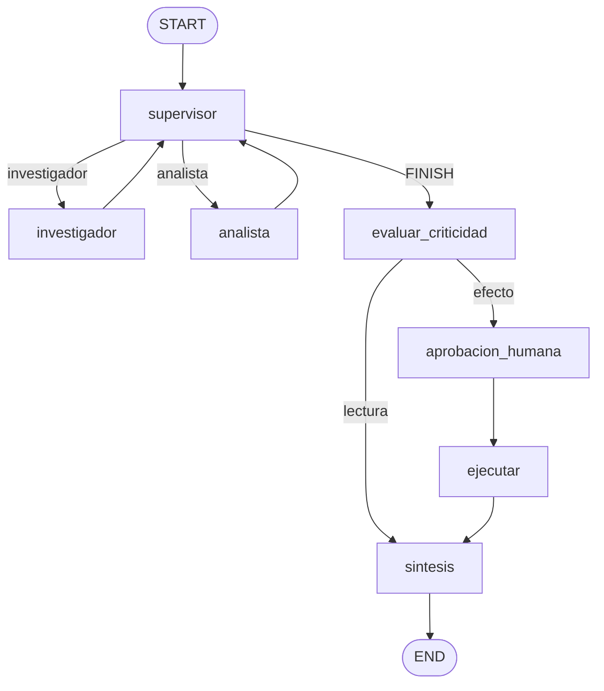

# Plan: agentes, RAG y chat

Subordinado a `capstone/FUENTE-DE-LA-VERDAD.md`. El prompt `04-agentes.md` y el mensaje de este agente piden lo mismo. Si algo difiere, gana la fuente. Este plan no la modifica.

Nada de la fuente impidió el grafo. Dos límites se anotan y se respetan, no se “arreglan” en ese archivo:

- Configuración no tiene variable para el embedding. Queda el modelo local de la pre-entrega 7, `sentence-transformers/all-MiniLM-L6-v2` (384 dimensiones). No se inventa `EMBEDDING_MODEL`.
- El lifespan de `app/main.py` compila el grafo con `RedisSaver` síncrono. Esa clase no implementa `aget_tuple`. Este agente no reescribe el lifespan. Por eso el worker sigue en `graph.invoke` dentro de un hilo, y la llamada al modelo es `ainvoke` corrida desde ese hilo.

`docs/plan-datos.md` ya exporta `consultar_gastos` con la firma que usa el analista, y `usuario_actual` lee el claim `sub`. `docs/plan-ingesta.md` importa `indexar_comprobante` con la firma de abajo. No se tocan `repositorio.py`, `auth.py`, `ingesta.py` ni las rutas de documentos.

## Mejores prácticas

Decisión: se conserva la maquinaria de la pre-entrega 7 (supervisor con salida estructurada y rúbrica que corrige al modelo, tope de pasos, worker con estados, checkpointer Redis, interrupt de HITL, trazas Phoenix ya inicializadas) y se cambia el dominio a comprobantes del hogar. Las tools tienen argumentos y resultado validados con Pydantic. `user_id` no está en ningún esquema que ve el modelo.

Opción descartada: reescribir el supervisor como un router nuevo, o dejar la rúbrica de TechCorp que exige investigador y analista en toda pregunta. Esa rúbrica manda al índice una pregunta de totales y al libro una pregunta sobre el texto. Las tres preguntas de la fuente no se pueden cumplir así.

La calculadora sigue evaluando un árbol `ast` (`+`, `-`, `*`, `/`, `**`, paréntesis y negativo unario). No llama a `eval` ni a `exec`.

## Arquitectura

Decisión: la topología de producción se mantiene. Los especialistas no se hablan: vuelven al supervisor. El cierre `FINISH` no entra directo a síntesis: pasa por la pausa que ya estaba, porque el efecto tiene que quedar en el nodo siguiente al `interrupt`. Si el efecto viviera en el mismo nodo que la pausa, al reanudar se ejecutaría de nuevo desde cero.



El diagrama de la fuente (FINISH derecho a síntesis) es este mismo ciclo. La arista FINISH está abierta en tres nodos para que asentar un pago quede en `AWAITING_APPROVAL` hasta `POST /tasks/{id}/approve`. Quitarlos sería reescribir la pausa que el worker ya sabe reanudar con `Command`.

Hay dos almacenes y no se mezclan. El analista lee montos con `repositorio.consultar_gastos`. El investigador lee texto con el retriever híbrido. Una pregunta de “cuánto” no va al índice. Una pregunta de “qué dice la factura” no va a SQL.

Tope: `MAX_PASOS = 6` en el supervisor y `MAX_POR_AGENTE = 2`. `config` del hilo lleva `recursion_limit = 25` por si la rúbrica fallara. El checkpointer es el `RedisSaver` del lifespan. La conversación sigue después de reiniciar el proceso porque el checkpoint y el dueño del `thread_id` están en Redis.

## Implementación

Decisión: el supervisor clasifica la pregunta y la rúbrica obliga el destino. El modelo con `DecisionSupervisor` solo se consulta si la pregunta es ambigua. Las tres preguntas de la fuente no dependen de la red ni de que el modelo acierte.

| Pregunta | Clase | Nodo | Tool |
| --- | --- | --- | --- |
| «¿Cuánto pagué de expensas en marzo?» y «¿Cuánto pagó de expensas en marzo?» | montos | analista | `consultar_gastos` |
| «Compará la luz de enero contra febrero.» | montos, comparación | analista | `consultar_gastos` y la calculadora |
| «¿Qué dice la factura de alquiler sobre el ajuste?» | texto | investigador | `buscar_comprobantes` |

Luz, gas, agua, internet y teléfono se consultan como categoría `servicios`. No se filtra `proveedor="luz"`: luz no es un proveedor. Expensas y alquiler usan esas categorías. Un mes sin año usa el año del reloj, no un año escrito en el código. El mes se pasa como `YYYY-MM` (`periodo_desde` y `periodo_hasta` iguales). Una comparación pide el rango y después la resta en la calculadora.

La rúbrica, con el modelo en desacuerdo, igual manda:

- Texto, sin un fragmento `[comprobante ...]` todavía y con intentos: investigador. Nunca al analista.
- Montos, sin un `Total:` del libro y con intentos: analista. Nunca al investigador. Si es comparación, además tiene que aparecer `Resultado:` de la calculadora.
- Las dos cosas en la misma pregunta: primero el índice, después el libro, después el cierre.
- Sin intentos, o con `pasos >= 6`: `FINISH`.

`FINISH` entra a `evaluar_criticidad`. Leer, comparar o preguntar qué dice la factura no pausa. Asentar un pago (u otra frase de efecto que ya pausaba la pre-entrega) pausa en `aprobacion_humana`. El job queda `AWAITING_APPROVAL`. `POST /tasks/{id}/approve` con `Aprobacion` reencola el mismo `thread_id`. Si `aprobado` es verdadero, `ejecutar` escribe el aviso de pago asentado. Si no, no escribe. No se agrega una tabla ni un `INSERT`: el efecto de la pre-entrega es el jsonl de `avisos/`, ahora con esa redacción cuando el pedido es un pago. `consultar_gastos` sigue siendo la única firma de repositorio que usa el grafo.

Cada pregunta nueva en un hilo manda un aporte `__reset__`. El reducer vacía las contribuciones de la pregunta anterior y pone `pasos` en 0. Los mensajes se acumulan: el supervisor y el HITL leen el último mensaje humano, no el primero. `texto.contexto_acotado` sigue mirando el primero; no se edita ese módulo. Los especialistas arman el turno ellos.

`user_id` vive en `AgentState` y en un `ContextVar` que el nodo setea antes de llamar al agente. Las tools lo leen ahí. El esquema Pydantic tiene `extra="forbid"`. Mandar `user_id` es un error de validación, no un filtro.

`buscar_comprobantes(consulta, categoria=None, periodo=None, proveedor=None)` filtra metadata `user_id` (siempre), categoría, período y proveedor. El proveedor se compara sin distinguir mayúsculas, después de la búsqueda, igual que el libro. Pinecone recibe `user_id` y, si vienen, categoría y período. Si Pinecone no está configurado o no responde, queda BM25 sobre los chunks locales. No se buscan los `data/*.txt` de políticas.

`consultar_gastos` del analista llama, con el `user_id` del estado:

`repositorio.consultar_gastos(*, user_id, categoria=None, periodo_desde=None, periodo_hasta=None, proveedor=None)`

El repositorio ya la exporta y devuelve `total`, `promedio`, `cantidad`, `por_mes`, `por_categoria`, `por_proveedor`. El adaptador está en `app/agents/libro.py`: importa la función en el momento de la llamada, le hace `await` si devuelve una corrutina, y formatea `Total:`. No copia SQL. Si el día de mañana el import falla, la tool devuelve el error y no inventa un total.

Índice y modelo de chat salen del entorno. `INDEX_NAME` y `PINECONE_API_KEY` vacíos no tienen default: no se usa el nombre `techcorp-rag-hibrido`. El chat sigue en `armar_llm()` (`OPENAI_MODEL` o `GEMINI_MODEL`). No se toca `llm.py`.

Llamadas al modelo: `ainvoke` (supervisor ambiguo, especialistas, síntesis). El nodo del grafo es síncrono porque `graph.invoke` es el que acepta `RedisSaver`. El worker ya corre ese `invoke` en un hilo, con `asyncio.run` de la corrutina en ese hilo, así el event loop de la API no espera al modelo. Pinecone, el embedding y BM25 son síncronos: van en `asyncio.to_thread` desde la corrutina, no con `requests` dentro de un `async def`.

`POST /tasks` no espera al modelo. Persiste `PENDING` con `user_id` y `thread_id`, hace `RPUSH` y responde 202. El worker pasa a `RUNNING`, corre el grafo y deja `DONE`, `AWAITING_APPROVAL` o `FAILED`. `GET` lee Redis y responde `TareaEstado`. Un job de otra persona, o un hilo de otra persona, es 404 con el mismo criterio que un id inexistente.

`thread_id` nulo crea un UUID. El cliente puede reenviar el que recibió. Redis guarda `gastos:threads:{thread_id} = user_id` con `SET NX`. El checkpointer usa ese id, no el `job_id`. Dos jobs del mismo hilo se serializan con un candado en el proceso para no pisar el checkpoint. La cola sigue siendo un `BLPOP`, la concurrencia `WORKER_CONCURRENCY` y un fallo del grafo deja `FAILED`. Un `RUNNING` huérfano al arrancar también queda `FAILED`. `AWAITING_APPROVAL` se conserva para el approve de después del reinicio.

Al confirmar, ingesta llama:

`async def indexar_comprobante(*, user_id: str, documento_id: str, texto: str, categoria: str, periodo: str, proveedor: str) -> None`

El módulo es `app/indexacion.py`. Parte el texto, lo guarda con esa metadata más `documento_id` (hace falta para reemplazar chunks y citar), intenta el upsert en Pinecone y, si Pinecone no responde, el local alcanza. No se crea el índice de Pinecone desde acá: tiene que existir con el nombre de `INDEX_NAME` y dimensión 384. Un fallo de Pinecone no borra el local. Texto vacío no escribe. Categoría distinta de `servicios`, `expensas` o `alquiler`, o un período que no es `YYYY-MM`, lanza `ValueError`. Ingesta ya decidió tragar ese error y igual responder 200.

El corpus local es `api/data/comprobantes.jsonl`, al lado del SQLite. No es un secreto. No se edita `.gitignore`: lo mismo pasa con `gastos.db`.

Namespace de Pinecone: `comprobantes`. No es una variable de la fuente; el índice sí lo es.

Trazas: `init_observability()` sigue en el lifespan y el instrumentor de LangChain ve los `ainvoke`. El worker mantiene el span `ejecutar_tarea` con `job.id` y `session.id` (el `thread_id`). No se loguea el token, el texto del comprobante ni la clave.

## Seguridad

Decisión: toda búsqueda y toda agregación llevan el `user_id` del token, puesto por el sistema. La tool no lo acepta. Sin `user_id` en el estado no se consulta el índice ni el libro. Un resultado de Pinecone cuyo metadata no coincide con ese usuario se descarta igual. `GET` y `approve` de un job ajeno responden 404, no 403. El `thread_id` que manda el cliente se ata al usuario; si ya tiene dueño, 404. Un `thread_id` con caracteres raros o de más de 200 caracteres es 422: el id que emitimos es un UUID.

Opción descartada: filtrar solo en el prompt, o usar el `job_id` como `thread_id`. Lo primero lo puede saltar el modelo. Lo segundo corta la conversación en cada mensaje y deja que otro usuario reanude un checkpoint si adivina el id.

`usuario_actual` se importa de `app.auth`. No se reescribe el hash ni el JWT. El claim que identifica es `sub`. La dependencia devuelve `user_id` y `email`; la ruta usa `user_id`. CORS sigue siendo solo `FRONTEND_ORIGIN`. No se loguea la contraseña, el token ni el archivo.

El efecto aprobado no abre SQL. Asentar el pago queda en el aviso local, después del `interrupt`, nunca antes.

## Documentación

Decisión: este plan es el lugar de la firma de indexación, de la rúbrica y del contrato de `/tasks`. No se escribe el README de la raíz: lo escribe el cierre. El diagrama de arriba es el que ese README tiene que poder copiar.

`POST /tasks` con `ConsultaTarea` responde 202 `TareaCreada`:

```json
{ "job_id": "...", "status": "PENDING", "thread_id": "..." }
```

`GET /tasks/{job_id}` responde 200 `TareaEstado` y no bloquea:

```json
{ "job_id": "...", "status": "DONE", "thread_id": "...", "result": "..." }
```

`status` es `PENDING`, `RUNNING`, `AWAITING_APPROVAL`, `FAILED` o `DONE`. En los estados que no son `DONE`, `result` puede ser null. No se agregan `error`, `interrupt` ni `user_id` a esa respuesta. `POST /tasks/{job_id}/approve` con `Aprobacion` (`{ "aprobado": true }`) responde 202 si estaba en `AWAITING_APPROVAL`. El body de esa respuesta no está congelado: se deja `{ "job_id", "status": "PENDING" }`, que es el job ya reencolado. Si no esperaba aprobación, 409. Si no existe o es de otra persona, 404.

OpenAPI muestra esos modelos porque las rutas los usan como body o `response_model`.

Tests en `api/tests/test_ruteo_supervisor.py`. Herramientas simuladas, `MemorySaver`, sin Redis y sin red. No se pisan `test_aislamiento.py` ni `test_extraccion.py`. `test_flujo.py` sigue cubriendo la pausa de la pre-entrega: las frases de RRHH y el umbral de monto se conservan.

## Escalabilidad

Decisión: un proceso, una cola Redis, `WORKER_CONCURRENCY` grafos a la vez, y un candado por `thread_id`. BM25 se arma sobre los chunks de ese usuario y esos filtros, no sobre el corpus entero. Pinecone filtra en el servidor. El embedding y el cliente de Pinecone se construyen una vez. Si Pinecone falla en una búsqueda, esa búsqueda usa BM25 y la siguiente vuelve a intentar, salvo que falte la configuración: eso no se reintenta en cada query.

Opción descartada: un retriever global sin filtro, armado al arrancar como el de las políticas, o un `EnsembleRetriever` cacheado con el `user_id` del primer pedido. El primero mezcla hogares. El segundo filtra mal a partir del segundo usuario.

No se agrega otro broker ni otro origen. El promedio y la suma salen de SQL, no del modelo. El frontend no entra en este plan.

## Qué queda afuera

- Tablas, `db.py`, `auth.py`, `repositorio.py`, hash de contraseñas y pantallas.
- `llm.py`, `esquemas.py`, `extraccion.py`, `ingesta.py`, `rutas_documentos.py`, `rutas_auth.py`.
- El título de FastAPI sigue diciendo TechCorp: en `main.py` solo se alinean `/tasks`, `/tasks/{id}` y `/approve`. CORS, lifespan y `_montar_router` no se tocan.
- `app/observability.py` no es de este agente. Si `PHOENIX_PROJECT` está vacío, el default de ese módulo sigue siendo el nombre viejo. El cierre lo setea en el entorno.
- `scripts/carga.py` todavía lee `error` e `interrupt` del GET. El contrato ya no los devuelve. No se edita ese script.
