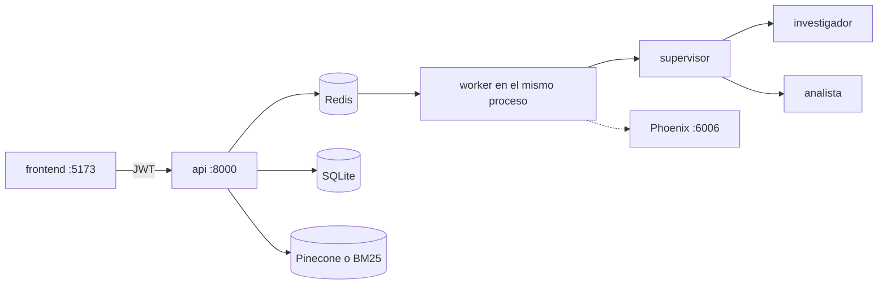

# Plan: cierre, despliegue y evidencia

Subordinado a `capstone/FUENTE-DE-LA-VERDAD.md`. Si este plan y ese archivo difieren, gana la fuente. No se modifica ese archivo, ni `capstone/prompts/`, ni `pre-entrega-7-api/`. No hay commit.

Nada de la fuente impidió el cierre. Lo que impide dejar las cinco trazas visibles es el entorno de esta máquina, no el contrato: no existe `capstone/api/.env`. Sin `JWT_SECRET`, clave del proveedor y nombre del modelo, el registro y el grafo no pueden completar una corrida. No se copia `pre-entrega-7-api/.env` y no se inventan capturas.

Este agente no reescribe auth, extracción, el grafo ni las pantallas. No agrega rutas ni features. El código de dominio que ya cumple se deja como está, desviaciones incluidas.

## Qué ya integra y no se toca

- `app/main.py` monta CORS desde `FRONTEND_ORIGIN` y llama `_montar_router(".rutas_auth")` y `_montar_router(".rutas_documentos")`. `POST /tasks` responde 202 con `ConsultaTarea` / `TareaCreada`.
- `ingesta.confirmar` llama `indexar_comprobante(*, user_id, documento_id, texto, categoria, periodo, proveedor)` de `app/indexacion.py` después de `confirmar_documento`.
- Firmas de `repositorio.consultar_gastos`, `confirmar_documento`, `guardar_borrador` y `auth.usuario_actual` (claim `sub`).
- `requirements.txt` ya trae el stack de la pre-entrega más `aiosqlite`, `argon2-cffi`, `PyJWT`, `pytest`, `pymupdf` y `python-multipart`.
- `api/.env.example` lista las variables de la fuente, con secretos, índice y modelos vacíos.
- El frontend es Vite, React, TypeScript, Chakra UI y Recharts. `VITE_API_URL` es la única variable. El token va a `sessionStorage`. `frontend/.env` solo tiene la URL de la API.
- El worker arranca en el lifespan del mismo proceso. No hace falta un quinto servicio.
- `api/Dockerfile` ya es Python 3.12. `api/.dockerignore` excluye `.venv` y `.env`.

Desviaciones que se conservan porque no impiden integrar: `graph.invoke` porque `RedisSaver` no tiene `aget_tuple`; `FINISH` pasa por `evaluar_criticidad` y la pausa humana antes de síntesis cuando hay efecto; el título de FastAPI sigue diciendo TechCorp; WebP se valida por contenedor RIFF; el embedding local sigue fijo porque Configuración no declara esa variable.

## Huecos que sí impiden la consigna

1. No hay comando único en la raíz. Faltan `capstone/docker-compose.yml`, `capstone/run.sh` y `capstone/README.md`. El `docker-compose.yml` de `capstone/api/` es el de la copia: levanta Redis y Phoenix, y deja la API detrás del perfil `full`, sin frontend. No es el comando de la entrega y no se reescribe.
2. `capstone/api/scripts/carga.py` sigue siendo el de TechCorp. Hace `POST /tasks` sin JWT, una sola consulta de vacaciones, lee `error` e `interrupt` (el `GET` ya no los devuelve) y apunta al proyecto `techcorp-api`. No hay dos usuarios, ni pregunta de totales, ni pregunta sobre el texto de una factura, ni prueba de que A no ve los gastos de B.
3. No existe `capstone/api/.env`. `JWT_SECRET` vacío hace fallar el registro. Sin clave y sin `OPENAI_MODEL` o `GEMINI_MODEL`, la extracción responde 502 y el worker deja el job en `FAILED`. Phoenix local no pide clave; el modelo sí. Las cinco trazas no se pueden fabricar.
4. `PHOENIX_PROJECT` vacío hace que `app/observability.py` use el default `techcorp-api`. El plan de agentes pide fijarlo en el entorno, no editar ese módulo.
5. `FRONTEND_ORIGIN` vacío deja la lista de CORS vacía. El código ya es el correcto; el compose tiene que publicar `http://localhost:5173`, que es el origen del navegador.
6. Dentro de un contenedor, Vite en `127.0.0.1` no se ve desde el host. El servicio tiene que arrancar con `--host 0.0.0.0`. No se cambia `vite.config.ts`.
7. `capstone/api/screenshots/` son capturas de TechCorp. No se copian a `capstone/screenshots/` ni se presentan como evidencia. Esa carpeta queda sin PNG si Phoenix no llegó a mostrar las cinco corridas.

## Mejores prácticas

Decisión: el comando único es `./run.sh` desde `capstone/`, y ese script solo hace `docker compose up -d --build` más la espera a que Phoenix y `GET /health` respondan, y un reinicio de la API para que el collector enganche si Phoenix llegó después. `carga.py` queda aparte, contra `http://localhost:8000`, y no se ejecuta solo al levantar.

Opción descartada: reescribir la API dentro del compose de `capstone/api/`, o hacer que `run.sh` copie secretos o dispare las cinco consultas. El primero pisa un archivo de la copia. El segundo mezclaría el arranque con una corrida que gasta el modelo y, sin `.env`, fallaría el comando que tiene que levantar lo que no depende de una clave.

## Arquitectura

Decisión: cuatro servicios en el compose de la raíz. Redis 8, Phoenix, la API (imagen del `Dockerfile` que ya está, worker adentro del proceso) y el frontend (imagen `node:22`, código montado, `npm ci` solo si falta `vite`). El navegador habla con `http://localhost:8000`. La API habla con `redis` y `phoenix` por nombre de servicio. SQLite y el jsonl del índice local viven en el volumen `./api/data`.

Opción descartada: un contenedor worker aparte, o servir el frontend con el `preview` de una imagen propia. El lifespan ya lanza el worker. Un Dockerfile nuevo del frontend no agrega una frontera que el compose no pueda cablear con la imagen de Node.

## Implementación

Decisión: el compose inyecta solo el cableado que cambia dentro de la red, y pisa el `.env` del usuario en esas claves: `REDIS_URL=redis://redis:6379/0`, `PHOENIX_COLLECTOR_ENDPOINT=http://phoenix:6006`, `PHOENIX_PROJECT=gastos-hogar`, `FRONTEND_ORIGIN=http://localhost:5173`, `SQLITE_PATH=/app/data/gastos.db`. El resto (`JWT_SECRET`, claves, modelos, `INDEX_NAME`, `PINECONE_API_KEY`, `LLM_PROVIDER`) entra por `env_file` de `api/.env` con `required: false`, para que el archivo ausente no impida el `up`. `load_dotenv` no pisa variables ya presentes, así que el hostname de Redis no vuelve a `localhost`.

`carga.py` se reemplaza. Habla solo HTTP. Registra dos personas (si el email existe, entra). Genera PDFs chicos en memoria, sin depender de PyMuPDF en el cliente. Confirma con `Factura`: Ada tiene expensas de marzo `18500.50`, luz de enero y de febrero, y un alquiler cuyo texto dice el ajuste; Bea tiene expensas de marzo `77777.77`. Después manda cinco `POST /tasks` y espera un estado terminal:

| # | Quién | Pregunta | Especialista |
| --- | --- | --- | --- |
| 1 | Ada | ¿Cuánto pagué de expensas en marzo? | analista, libro SQL |
| 2 | Ada | Compará la luz de enero contra febrero. | analista y calculadora |
| 3 | Ada | ¿Qué dice la factura de alquiler sobre el ajuste? | investigador, índice |
| 4 | Bea | ¿Cuánto pagué de expensas en marzo? | analista, el libro de Bea |
| 5 | Bea | ¿Qué dice la factura de alquiler sobre el ajuste? | investigador, no el texto de Ada |

La prueba de aislamiento no depende de cómo redacte el modelo: `GET /resumen` de Ada no incluye `77777.77` ni los id de Bea; el de Bea no incluye `18500.50` ni los id de Ada; `GET /documentos/{id}` cruzado responde 404. Los períodos sin año usan el año del reloj, que el analista ya inyecta: en esta máquina es 2026, así que los comprobantes van en `2026-01`, `2026-02` y `2026-03`.

Si falta `api/.env`, o `JWT_SECRET`, o la clave y el modelo del proveedor elegido, el script sale con código distinto de cero y nombra la variable vacía. No imprime tokens ni valores. No escribe PNG.

Opción descartada: sembrar SQLite a mano o agregar un endpoint de carga. El script tiene que ser ejecutable contra la API. Sin modelo, la carga de comprobantes y las trazas se informan como bloqueadas; no se simula un `DONE`.

## Seguridad

Decisión: ningún secreto entra al compose, al README, al bundle ni a un `.env` creado por este agente. `run.sh` no copia `pre-entrega-7-api/.env`. Si falta `api/.env`, el script dice el `cp api/.env.example api/.env` y sigue con Redis, Phoenix, frontend y API. El frontend del compose solo recibe `VITE_API_URL=http://localhost:8000`. `carga.py` no loguea el Bearer. Las contraseñas de Ada y Bea son frases fijas de la prueba, no claves del usuario.

Opción descartada: un `JWT_SECRET` de desarrollo escrito en el compose para que el registro funcione sin `.env`. Sería un secreto en el repositorio. La fuente lo deja en `.env`.

## Documentación

Decisión: `capstone/README.md` explica cómo crear el `.env`, cómo levantar con `./run.sh`, cómo correr `carga.py` y cómo mirar Phoenix en el proyecto `gastos-hogar`. Lleva el diagrama real del grafo (el de `plan-agentes.md`, con la pausa antes de síntesis) y el diagrama de frontend a API. Dice el límite: los totales del dashboard y del analista salen del `SUM` de SQLite; el texto de las facturas lo lee el investigador en el índice. Apunta a `FUENTE-DE-LA-VERDAD.md` como contrato y no lo reemplaza. Si las cinco trazas no se vieron, nombra la variable o el servicio que faltó. `capstone/api/README.md` queda como el de la copia.

Opción descartada: presentar `api/screenshots/` en el README de la raíz, o escribir un PNG de ejemplo. Esas imágenes son de otro dominio.

## Escalabilidad

Decisión: un proceso de API, `WORKER_CONCURRENCY` como ya lo lee el worker, una cola Redis y Phoenix al lado. No se agrega otro broker ni se parte el worker. El volumen de `api/data` conserva el libro y el BM25 local entre reinicios del contenedor.

Opción descartada: réplicas de la API. Dos procesos escribirían el mismo SQLite y el candado del `thread_id` es del proceso, no del clúster. Eso ya lo dejó el plan de datos para un cambio de driver, no para este cierre.

## Archivos de este agente

| Archivo | Qué hace |
| --- | --- |
| `docs/plan-cierre.md` | este plan |
| `README.md` | cómo levantar, probar, diagramas y el límite SQL / índice |
| `docker-compose.yml` | Redis, Phoenix, API y frontend |
| `run.sh` | el comando único |
| `api/scripts/carga.py` | cinco ejecuciones, dos usuarios, aislamiento |
| `screenshots/` | solo PNG salidos de Phoenix o LangSmith |

Cableado que no es un archivo nuevo de dominio: variables de red en el compose y el `--host` del servicio frontend. No se edita `main.py`, `ingesta.py`, `observability.py` ni las pantallas: la frontera ya está en el código y le faltaba el entorno.

## Resultado de la corrida

`./run.sh` terminó en 0. Construyó la imagen de la API (Python 3.12) y dejó los cuatro servicios arriba: Redis sano, Phoenix, API (`GET /health` → `{"status":"ok"}`) y frontend (Vite respondió 200). CORS de `http://localhost:5173` responde en el preflight. OpenAPI lista `/auth`, `/documentos`, `/resumen` y `/tasks`. El log de la API dice que Phoenix recibe el proyecto `gastos-hogar` en `http://phoenix:6006/v1/traces`.

En esta máquina `pre-entrega-7-api` ya ocupaba 6379, 6006 y 4317. No se apagaron esos contenedores. `run.sh` publicó Redis en el host en el 6380 y Phoenix en el 6007. Adentro de la red siguen siendo `redis:6379` y `phoenix:6006`. El 4317 de Phoenix no se publica: las trazas van por HTTP.

`api/.env` no existe y no se creó. En el contenedor `JWT_SECRET`, las claves y los nombres de modelo están vacíos. `carga.py` salió con código 2, vio el health 200 y nombró el archivo que falta. No hubo cinco jobs, ni spans de supervisor, investigador o analista, ni costo, ni latencia. `screenshots/` sigue sin PNG. Las capturas de `api/screenshots/` no se copiaron.
