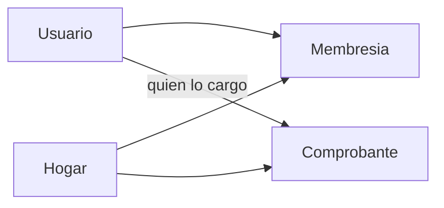

# Plan: hogares

Diferido. Este diseño se ejecuta después del MVP. Hasta entonces no se escribe código de hogares, no se cambian rutas y no se toca `FUENTE-DE-LA-VERDAD.md`.

Subordinado a `capstone/FUENTE-DE-LA-VERDAD.md`. Hoy ese archivo deja fuera de alcance los roles y el multi-usuario dentro de un mismo hogar. Ejecutar este plan exige, en ese momento, una autorización explícita en el chat para actualizar la fuente y `docs/documentacion-funcional.md`. Guardar este archivo no es esa autorización.

## Decisiones ya tomadas

- Hogar y propiedad son la misma cosa: nombre y dirección opcional. Un usuario puede tener varios.
- Cada hogar tiene un administrador y asociados. El asociado se agrega por el email de una cuenta que ya existe.
- El asociado carga y confirma sus comprobantes. El administrador corrige, anula y ve el tablero, el export y el chat de todo el hogar.
- Fuera de este corte: baja del hogar, más de un administrador, invitación a quien todavía no tiene cuenta, y que el asociado vea totales o el chat.

## Conclusión

Se puede hacer. El código actual no lo permite: cada fila de `api/app/db.py` apunta solo a `usuarios.user_id`. El resumen, el chat, el índice y la caché filtran por esa persona. En la interfaz no hay selector de hogar: `frontend/src/componentes/BarraLateral.tsx` muestra el email y cuatro secciones fijas.

## Bloqueo de contrato

`FUENTE-DE-LA-VERDAD.md` dice que una persona no ve comprobantes, totales ni conversaciones de otra, y deja fuera de alcance los roles y el multi-usuario dentro de un mismo hogar. `docs/documentacion-funcional.md` repite el aislamiento por persona y dice que no hay hogar compartido.

Al retomar el plan, el primer paso es esa autorización. Sin ella, el código no se modifica.

## Modelo

Tablas nuevas en `db.py`, creadas en el primer `conectar()` como el resto del esquema:

- `hogares`: `hogar_id`, `nombre`, `direccion` (opcional), `creado_en`.
- `membresias`: `hogar_id`, `user_id`, `rol` (`administrador` o `asociado`). Clave primaria `(hogar_id, user_id)`. Un índice único parcial de SQLite garantiza un solo administrador por hogar.

`borradores`, `comprobantes` y `mensajes` ganan `hogar_id`. `user_id` se queda: es quien subió el archivo o quien escribió en el chat. Los archivos siguen en `archivos/{user_id}/{documento_id}`; el permiso se resuelve al leer, sin mover bytes.

Al registrarse, la persona recibe un hogar «Mi hogar» del que es administrador, así la carga actual sigue teniendo destino. La migración en `_migrar` hace lo mismo con los usuarios que ya existen y copia ese `hogar_id` a sus borradores y comprobantes. La columna nueva entra nullable, se rellena, y el repositorio rechaza escrituras sin hogar.

## Permisos

El hogar activo viaja en el cliente (`sessionStorage`) y la API lo exige en altas y listados. En un comprobante que ya existe, el hogar se lee de la fila: no se confía en el id que mande el navegador.

- Quien no es miembro recibe 404, igual que hoy cuando un id es de otra persona (`api/tests/test_aislamiento.py`).
- Asociado: sube, ve, descarga, descarta y confirma solo sus documentos de ese hogar. No corrige, no anula, no ve totales, no exporta, no usa el chat y no gestiona miembros. Si se equivocó después de confirmar, lo corrige el administrador.
- Administrador: ve borradores y confirmados de todos los miembros, con el email de quien cargó. Corrige, anula, exporta y consulta el chat sobre el libro del hogar. Edita nombre y dirección. Agrega un asociado por email (404 si la cuenta no existe, 409 si ya está) y lo quita. No puede quitarse a sí mismo.

El cupo diario de cargas y consultas sigue siendo por usuario. La caché de `api/app/cache_resumen.py` pasa de `gastos:resumen:{user_id}:…` a `gastos:resumen:{hogar_id}:…`, y se invalida cuando cualquiera confirma, anula o corrige en ese hogar.

## Dónde se toca el código, al retomar

- Datos y reglas: `api/app/db.py`, `api/app/repositorio.py`, `api/app/esquemas.py`. Rutas nuevas `GET/POST /hogares`, `PATCH /hogares/{id}`, `POST/DELETE /hogares/{id}/miembros`.
- Documentos y resumen: `api/app/rutas_documentos.py`, `api/app/ingesta.py`. `consultar_gastos` y el resumen filtran por `hogar_id` y, para un asociado, también por su `user_id`.
- Chat e índice: el job guarda `hogar_id` y solo lo crea un administrador. `api/app/rag.py` agrega `hogar_id` a la metadata y al filtro (hoy `filtro_pinecone` solo usa `user_id`). Los comprobantes ya indexados se marcan para reindexar, si no el investigador seguiría viendo solo los vectores viejos de una persona. `api/app/agents/analyst_agent.py` y `api/app/agents/research_agent.py` leen el hogar del estado, nunca del modelo.
- Interfaz: `frontend/src/api/tipos.ts` y `frontend/src/api/cliente.ts`. Selector de hogar en la barra lateral, alta y edición, y alta de asociados por email. Con rol asociado, la barra deja visibles Cargar y Registros. La caché de resumen del navegador incluye el hogar activo.
- Pruebas: dos hogares no se mezclan; el asociado no lee el documento de otro ni el resumen; el administrador ve la suma de ambos; un email inexistente no entra.

## Orden al ejecutarlo

1. Autorización explícita para actualizar `FUENTE-DE-LA-VERDAD.md` y `docs/documentacion-funcional.md`.
2. Tablas `hogares` y `membresias`, `hogar_id` en borradores, comprobantes y mensajes, y la migración que crea «Mi hogar» para cada usuario existente.
3. Rutas de hogares y miembros, y filtrar documentos, resumen, export, jobs y chat según rol y hogar activo.
4. Caché de resumen y metadata RAG por `hogar_id`, y reindexar comprobantes ya confirmados.
5. Selector, alta y edición de hogares, alta de asociados por email, y ocultar tablero y chat al asociado.
6. Pruebas de aislamiento entre hogares y del límite del asociado frente al administrador.
