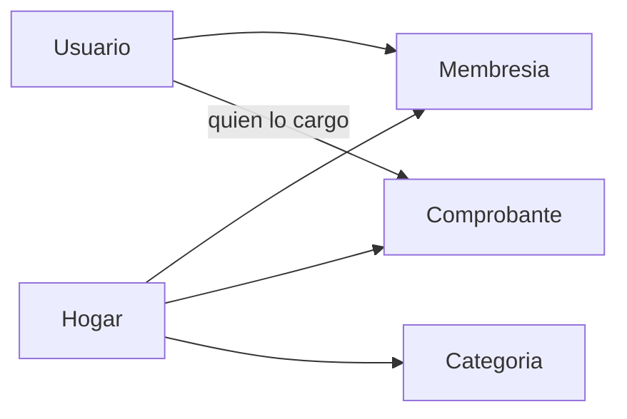

# Plan: hogares

Listo para ejecutar. Este pedido autoriza a actualizar `FUENTE-DE-LA-VERDAD.md` y `docs/documentacion-funcional.md`: el producto pasa de un libro por persona a un libro por hogar. El resto de lo que la fuente deja fuera (OAuth, recuperación de clave, panel de administración, más de un archivo, OCR propio, totales en el navegador) no se toca.

La base es la app al cierre del commit de respaldo: el SQL vive en `api/app/repositorio/`, no en un `repositorio.py`. Hay categorías por persona, cargas en cola, canal y bandeja por usuario, cuenta editable y baja de cuenta.

## Decisiones

- Hogar y propiedad son la misma cosa. Campos: `hogar_id`, `nombre`, `direccion` opcional, `creado_en`.
- Un usuario puede tener varios hogares. En cada uno hay un solo `administrador` y cero o más `asociado`. El índice único parcial es `membresias(hogar_id) WHERE rol = 'administrador'`.
- El asociado entra por el email de una cuenta que ya existe. 404 si no existe, 409 si ya es miembro.
- El asociado carga y confirma sus comprobantes. Ve, descarga y descarta solo los suyos. No corrige, no anula, no borra confirmados, no ve totales, no exporta, no usa el chat y no administra miembros ni categorías.
- El administrador ve borradores y confirmados de todos, con el email de quien cargó. Corrige, anula, borra, exporta y usa el chat sobre el libro del hogar. Edita nombre y dirección. Agrega y quita asociados. No puede quitarse a sí mismo.
- Quien no es miembro recibe 404.
- Fuera de este corte: baja del hogar, más de un administrador, invitación a quien no tiene cuenta, totales o chat para el asociado.

## Qué cambió en la app y cómo entra en este plan

- `api/app/repositorio/` reexporta la API desde `__init__.py`. Hogares es un módulo nuevo, `repositorio/hogares.py`. No se recrea `repositorio.py`.
- `categorias` es una tabla por `user_id`, con único `(user_id, nombre)`. Pasa a ser del hogar: `hogar_id` reemplaza a `user_id` como dueño, único `(hogar_id, nombre)`. Siguen valiendo las claves `servicios`, `expensas` y `alquiler` sin fila. Cualquier miembro puede listar. Crear, editar y borrar es del administrador. `_categoria_para_gasto` busca por `hogar_id`.
- `POST /documentos` responde 202 y el worker de `cargas.py` termina el borrador. El job de Redis guarda `hogar_id` y `guardar_borrador` lo escribe en la fila.
- `notificaciones` y el canal (`canal_usuario`) siguen siendo de la persona. Al confirmar un asociado, `emitir` también avisa al administrador de ese hogar. La bandeja no se filtra por hogar.
- `mensajes` y `hilos_estado` ganan `hogar_id`. El chat y `POST /tasks` exigen rol administrador y guardan ese id en el job. Las tools leen el hogar del estado, nunca del modelo.
- `usuarios.nombre`, cambio de email y clave, y `DELETE /auth/cuenta` ya existen. `crear_usuario` crea el hogar «Mi hogar» y la membresía de administrador. `eliminar_usuario` borra membresías de hogares donde está solo. Si es administrador y hay otros miembros, responde 409 y no borra la cuenta. Un asociado puede borrar su cuenta: sus comprobantes se van con él, como hoy.
- La caché `gastos:resumen:{user_id}:…` pasa a `gastos:resumen:{hogar_id}:…`. Se invalida al confirmar, anular, corregir, borrar o asentar un pago en ese hogar.
- El índice guarda `hogar_id` en la metadata y filtra por ese campo. La migración deja `indexado` en NULL. No reindexa dentro del `ALTER`.
- La barra ya tiene Tablero, Registros, Categorías, Cargar, Chat y el menú de cuenta (`/opciones`). El selector de hogar va arriba de esas secciones. Categorías, Tablero y Chat se ocultan para el asociado. La gestión del hogar y de los miembros va en `/opciones#hogar`.
- CORS con `FRONTEND_ORIGIN_EXTRA` y el reintento de JSON del modelo no se mezclan con hogares.

## Modelo



`borradores` y `comprobantes` ganan `hogar_id`. `user_id` sigue siendo quien subió el archivo. Los bytes siguen en `archivos/{user_id}/{documento_id}`.

El hogar activo viaja en `sessionStorage` (`gastos.hogar_id`) y en el header `X-Hogar-Id` de las llamadas privadas. Si el header falta, se usa el hogar «Mi hogar» de esa persona, o el primero donde es administrador. En un documento que ya existe, el permiso se resuelve con el `hogar_id` de la fila.

La migración, dentro de `_migrar`, crea un hogar «Mi hogar» por cada usuario que no tenga membresía y copia ese id a sus borradores, comprobantes, mensajes, hilos y categorías. Las columnas entran nullable, se rellenan, y el repositorio rechaza escrituras nuevas sin hogar.

## Contrato HTTP nuevo

- `GET /hogares` lista los hogares del token, con `rol`.
- `POST /hogares` crea uno y deja al autor como administrador.
- `PATCH /hogares/{id}` edita nombre y dirección. Solo administrador.
- `GET /hogares/{id}/miembros` lista email, nombre y rol. Solo administrador.
- `POST /hogares/{id}/miembros` body `{ "email": "..." }`. Solo administrador.
- `DELETE /hogares/{id}/miembros/{user_id}` quita un asociado. Solo administrador. No quita al administrador.

`GET /resumen`, `GET /export`, `GET /documentos`, `POST /documentos` y `POST /tasks` usan el header. Un asociado en resumen, export o tasks recibe 403, porque el hogar le existe.

## Firmas que comparten las partes

```python
async def membresia(user_id: str, hogar_id: str) -> str | None
async def hogar_por_defecto(user_id: str) -> str | None

async def guardar_borrador(*, user_id: str, hogar_id: str, texto: str, campos: dict, advertencias: list[str]) -> str
async def listar_documentos(*, user_id: str, hogar_id: str, rol: str) -> list[dict]
async def resumen(*, user_id: str, hogar_id: str, rol: str, desde: str, hasta: str) -> dict
async def consultar_gastos(*, user_id: str, hogar_id: str, rol: str, categoria: str | None = None, periodo_desde: str | None = None, periodo_hasta: str | None = None, proveedor: str | None = None) -> dict

async def indexar_comprobante(*, user_id: str, hogar_id: str, documento_id: str, texto: str, categoria: str, periodo: str, proveedor: str) -> None
```

`rol` es `administrador` o `asociado`. El administrador agrega sobre todo el hogar. El asociado agrega solo sus filas. `consultar_gastos` con rol asociado no se expone por el chat.

La clave de caché queda `clave(hogar_id, desde, hasta)`.

## Partes y archivos

Cada parte escribe solo sus archivos. Las pruebas de esa parte van en el mismo corte.

1. Datos. `api/app/db.py`, `api/app/repositorio/hogares.py`, `api/app/repositorio/usuarios.py`, `api/app/repositorio/__init__.py`, modelos de hogar en `api/app/esquemas.py`, `api/app/rutas_hogares.py`, la línea que monta ese router en `api/app/main.py`, `api/tests/test_hogares.py`. También el párrafo de producto y el fuera de alcance en `FUENTE-DE-LA-VERDAD.md` y `docs/documentacion-funcional.md`.
2. Documentos, categorías, cargas y resumen. `api/app/repositorio/documentos.py`, `api/app/repositorio/categorias.py`, `api/app/ingesta.py`, `api/app/rutas_documentos.py`, `api/app/rutas_categorias.py`, `api/app/cargas.py`, `api/app/cache_resumen.py`, el `GET /resumen` de `api/app/rutas_auth.py`, el aviso al administrador en la confirmación. Tests de aislamiento, categorías y extracción que estas firmas rompan.
3. Chat e índice. `api/app/rag.py`, `api/app/indexacion.py`, `api/app/agents/`, `api/app/state.py`, `api/app/worker.py`, `api/app/graph.py` si el estado inicial necesita `hogar_id`, `POST /tasks` en `api/app/main.py`, `api/app/repositorio/hilos.py`, `api/app/rutas_hilos.py`. Tests de hilos y de flujo.
4. Interfaz. `frontend/src/api/tipos.ts`, `frontend/src/api/cliente.ts`, `frontend/src/api/cacheResumen.ts`, `frontend/src/almacen.ts`, `frontend/src/sesion.tsx`, `frontend/src/componentes/BarraLateral.tsx`, `frontend/src/componentes/MarcoPrivado.tsx`, `frontend/src/pantallas/Opciones.tsx` y las pantallas que listan o cargan. El asociado no ve Tablero, Chat ni Categorías.

Orden: 1 termina antes de 2 y 3. 2 y 3 no comparten archivos y pueden ir juntas. 4 empieza cuando 2 y 3 ya responden.
