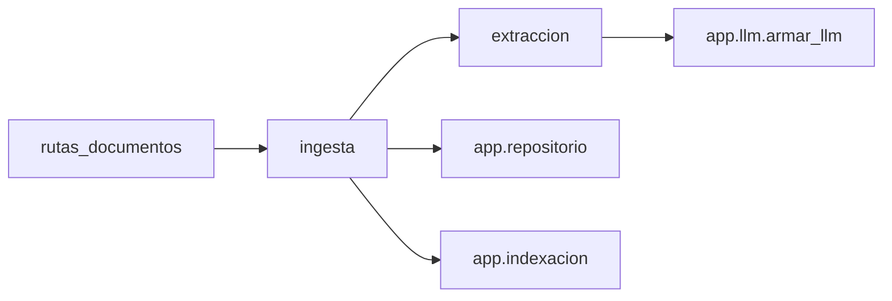

# Plan: ingesta de foto y PDF

Subordinado a `capstone/FUENTE-DE-LA-VERDAD.md`. Si ese archivo y este plan se pisan, se corrige este plan. Nada de la fuente impidió avanzar: no hay nota de bloqueo y ese archivo no se toca.

Este agente cubre los dos caminos de lectura, el tope de un archivo y de tamaño, el tipo real, el borrador, la confirmación y el enganche para indexar. No implementa el supervisor, el retriever, las pantallas, ni tablas. No modifica `esquemas.py`, `llm.py`, `main.py`, el grafo ni `frontend/`.

Las firmas del repositorio no se inventan acá. El código de ingesta espera a `docs/plan-datos.md`, sección `## Firmas del repositorio`, y llama solo lo que esa sección publique. La tarea ya anticipa estos nombres; si el archivo de datos los escribe distinto, gana ese archivo:

- `guardar_borrador(*, user_id, texto, campos, advertencias) -> str`
- `obtener_documento(*, user_id, documento_id) -> dict | None`
- `listar_documentos(*, user_id) -> list[dict]`
- `confirmar_documento(*, user_id, documento_id, campos) -> dict | None`

`None` es 404, exista o no el documento de otra persona. Las rutas no contienen SQL. Si al momento de codear `repositorio.py` todavía no exporta esas funciones, se importan igual con esos nombres.

## Mejores prácticas

Decisión: tres módulos con una sola responsabilidad, y un único resultado interno para los dos caminos. `extraccion.py` recibe bytes y devuelve texto, campos y advertencias. `ingesta.py` aplica los topes, persiste y dispara la indexación. `rutas_documentos.py` traduce HTTP. El modelo se pide con `armar_llm().with_structured_output(...)` y `ainvoke`. La salida pública pasa siempre por los modelos de `esquemas.py`.

Opción descartada: un solo archivo de rutas que abra el PDF, llame al modelo y arme el JSON a mano, o usar `Factura` tal cual como esquema del modelo. `Factura` exige proveedor, categoría, período y monto. Un borrador puede volver con `campos` incompletos (`{}` es válido) y la persona los corrige antes de confirmar. Forzar `Factura` en la lectura convertiría una foto a medias en un error y se perdería el paso de revisión. El esquema que ve el modelo, `LecturaFactura`, tiene los mismos campos que `Factura`, todos opcionales, más una `transcripcion` que solo llena el `texto` del contrato cuando no hay capa de texto. Esa transcripción no sale como campo nuevo del JSON. Lo que no cumple el formato de `CamposDocumento` se descarta y queda en `advertencias`. Los dos caminos pasan por esa misma lectura y la misma respuesta.

## Arquitectura

Decisión: la ruta no habla con el modelo ni con SQLite. `POST /documentos` termina en `guardar_borrador` y no llama a `confirmar_documento` ni al índice. Confirmar escribe el libro y, después, indexa el texto que ya estaba guardado en el borrador. El `user_id` entra por `usuario_actual` (`app.auth`); no se redefine esa dependencia y no se lee `user_id` del body ni del formulario.



Opción descartada: indexar en el `POST` o volver a mandar el archivo al confirmar. El monto no entra al libro hasta la confirmación, y el texto indexado tiene que ser el que se guardó al subir, no uno que el cliente pueda colar en el body. `Factura` no trae `texto` y `extra="forbid"` rechaza un campo de más. La metadata del índice (`user_id`, categoría, período, proveedor) sale del token y de la `Factura` ya validada, que es la versión corregida por la persona.

El PDF con texto seleccionable se lee en el proceso y el modelo solo completa los campos. La foto, o el PDF con poco texto, manda imágenes al mismo modelo. No hay una rama por proveedor: `armar_llm()` ya eligió OpenAI o Gemini.

## Implementación

Decisión: PyMuPDF para las dos lecturas del PDF, tipo por bytes de cabecera, y la llamada de visión por `ainvoke` después de preparar las imágenes en un hilo.

Opciones descartadas: Tesseract u otro OCR; `pdf2image` más Poppler, porque mete un binario de sistema que este agente no puede declarar en la imagen; `pypdf` solo, porque no rasteriza; Pillow o `python-magic`, porque la cabecera más abrir el archivo con PyMuPDF alcanza para estos cuatro tipos y no agrega otra librería; `requests` o `.invoke()` dentro de un `async def`.

Constantes, en código y no en `.env`. La fuente lista las variables y no incluye un tope de upload ni un umbral de texto. No se edita `.env.example`.

| Constante | Valor | Motivo |
| --- | --- | --- |
| Tamaño máximo | 10 MiB (`10 * 1024 * 1024`) | Una foto de teléfono de un comprobante entra. No se lee el resto del stream: en cuanto pasa el tope, 413, sin rasterizar y sin llamar al modelo. |
| Poco texto | menos de 40 caracteres después de colapsar espacios | Una factura digital corta sigue el camino de texto. Un escaneo que solo deja un pie de página no. |
| Páginas de visión | las dos primeras | Tope de la fuente. Un PDF de tres páginas manda dos imágenes. |
| Raster | PNG a 150 dpi, en memoria | Alcanza para leer un comprobante y no multiplica el payload como 300 dpi. No se escribe el archivo a disco. |

Tipo real, en este orden, sin mirar la extensión ni `Content-Type`: PDF `%PDF`, PNG `\x89PNG\r\n\x1a\n`, JPEG `\xff\xd8\xff`, WebP `RIFF` y `WEBP` en el offset 8. Después PyMuPDF abre el stream y, en JPEG o PNG, renderiza la imagen: un archivo truncado a veces reporta una página y el pixmap falla. Si la cabecera miente o el archivo está truncado, no se llama al modelo.

Un solo archivo por request. El campo se llama `archivo` (`CAMPO_ARCHIVO`). Cero archivos, el campo con otro nombre, o más de una parte de archivo: 422. El body de confirmar es `Factura`: proveedor vacío, período o monto ausentes o mal formados responden 422 por ese modelo, sin copiar sus regex. Categoría también es obligatoria ahí; no se afloja.

Normalización antes de `CamposDocumento`, solo cuando no es ambigua. Monto: se acepta el string del contrato, coma decimal, miles con punto o coma, símbolo de moneda y un entero, que pasa a dos decimales (`18500` → `18500.00`). Más de dos decimales se descarta, no se redondea. Período: `YYYY-MM`, `YYYY/MM`, `MM/YYYY` y el nombre del mes en español más el año. Categoría: se baja a minúsculas y solo valen `servicios`, `expensas` y `alquiler`. Lo que no entra se omite y genera una advertencia. Si faltan proveedor, período o monto en la lectura, el borrador se guarda igual y la advertencia lo dice. Moneda ausente queda en `ARS`.

`texto` del borrador: en el PDF con texto, el texto extraído, no un parafraseo del modelo. En la foto o el PDF casi vacío, la transcripción que devuelve la misma llamada de visión. Si esa transcripción viene vacía, `texto` es el poco texto que hubiera y se agrega una advertencia. Confirmar indexa ese `texto` guardado. `confirmar_documento` lo devuelve en el dict (plan de datos: `id`, `estado`, `campos` y `texto`). No se vuelve a abrir el archivo ni se acepta el texto en el body. Si ese dict no trajera `texto`, se indexa un string vacío y la respuesta sigue en 200: la fila en SQLite ya quedó escrita.

PyMuPDF se importa al cargar `extraccion.py`. Si el paquete no está, eso se convierte en `RuntimeError`. `main.py` se traga cualquier `ModuleNotFoundError` al incluir el router; sin esta conversión las rutas de documentos no se montarían y el proceso seguiría arriba sin ellas.

El wheel de PyMuPDF 1.28 no trae handler para `webp` (`cannot find document handler for file type: webp`). JPEG y PNG sí se abren con esa librería. WebP se acepta si el contenedor RIFF declara un tamaño que coincide con el archivo y el primer chunk es `VP8`, `VP8L` o `VP8X` con un largo que entra en el buffer. Un encabezado solo, o un archivo truncado, es 415. Al modelo se manda el WebP original, sin Pillow y sin reencode.

Errores de modelo (`ErrorDeModelo`): timeout, fallo del proveedor, respuesta vacía o `armar_llm()` sin variable de entorno. No se guarda borrador. La ruta responde 502 con el detalle fijo `No se pudo leer el comprobante.` Sin `str(exc)` y sin traceback en el body. Un PDF que PyMuPDF no abre es 422 con un detalle fijo, no un 502.

La preparación del PDF y de las imágenes corre en `asyncio.to_thread`. El base64 se arma en ese mismo hilo. La llamada al modelo es `await runnable.ainvoke(...)`. El mensaje de visión usa el bloque `image_url` con data-URL, el mismo para los dos proveedores. Como máximo dos imágenes. `armar_llm()` no se envuelve con otra temperatura ni con otro nombre de modelo.

Enganche de indexación, en `ingesta.py`. Al confirmar, después de que `confirmar_documento` devuelve el dict:

```python
async def _indexar_noop(
    *,
    user_id: str,
    documento_id: str,
    texto: str,
    categoria: str,
    periodo: str,
    proveedor: str,
) -> None:
    return None
```

Cada confirmación intenta `from app.indexacion import indexar_comprobante` (import relativo equivalente). Si falla con `ImportError` porque el agente del grafo todavía no dejó el módulo o la función, se espera la corrutina no-op. Si la función existe y lanza, se loguea solo el tipo de la excepción y el id del documento, y la respuesta sigue en 200 con lo ya persistido. No se implementa Pinecone, BM25 ni el retriever. No se deshace el `UPDATE` de SQLite.

Firma que se invoca, con argumentos por nombre:

`async def indexar_comprobante(*, user_id: str, documento_id: str, texto: str, categoria: str, periodo: str, proveedor: str) -> None`

| Situación | Estado |
| --- | --- |
| Falta el campo, hay más de un archivo, o el archivo está vacío | 422 |
| Supera 10 MiB | 413 |
| La cabecera no es jpeg, png, webp ni pdf, o el contenedor no abre | 415 |
| El PDF no se puede abrir | 422 |
| El modelo falla | 502, detalle fijo |
| Borrador creado | 201 `DocumentoBorrador` |
| Lista | 200 `ListaDocumentos` |
| Detalle propio | 200 `DocumentoDetalle` |
| Id ajeno o inexistente, también al confirmar | 404, el mismo detalle en los dos casos |
| Confirmar con `Factura` válida | 200 `DocumentoConfirmado` |
| Faltan proveedor, período o monto al confirmar | 422 |

El 404 no dice si el id existe. El JSON de error es el `{"detail": ...}` de `HTTPException`.

Tests en `tests/test_extraccion.py`. El PDF de texto se genera en el test con PyMuPDF. El modelo se reemplaza por un doble con `ainvoke` cuyo `invoke` sincrónico falla el test si alguien lo llama. La app de prueba monta solo `router`, sin lifespan y sin Redis, y pisa `usuario_actual`. Si `app.repositorio` importa y exporta las cuatro funciones, el test usa SQLite temporal con la inicialización que documente el plan de datos. Si el módulo no importa, el test instala un doble con esas firmas. Se cubre el camino de texto, el de visión con una imagen y con un PDF de tres páginas (llegan dos), la extensión mentirosa, el tipo inválido, el tamaño, el archivo de más, el 502 sin fuga del mensaje del modelo, el borrador que no confirma, el 422 al confirmar incompleto, el 404 cruzado entre dos usuarios, y la confirmación que responde 200 cuando el import de `app.indexacion` lanza `ImportError`.

`requirements.txt` solo suma, con `flock` y sin reescribir el archivo, las líneas que falten: `pymupdf>=1.24.14,<2` y `python-multipart`. FastAPI necesita el segundo para el multipart. El tope `<2` es porque la serie 2 de PyMuPDF arrastra un runtime de layout que no hace falta para leer texto ni rasterizar. No se agrega pytesseract, pdf2image, Pillow ni requests.

## Seguridad

Decisión: el archivo se trata como dato sensible de la persona y el fallo del modelo no se reexpone.

Opción descartada: loguear la excepción completa, el body del proveedor o el `Content-Type` junto con los bytes. Un error de OpenAI o Gemini a veces repite el request. En el log entra el nombre de la clase y, solo si el mensaje es corto y no contiene `bearer`, `sk-`, `api_key`, `token`, `password`, `data:image` ni `%pdf`, el mensaje. Nunca la contraseña, el token, el secreto, el archivo crudo, el base64 ni el texto del comprobante. Al cliente, el 502 es la frase fija.

Toda lectura y toda escritura lleva el `user_id` del token. Un documento de otra persona es 404, no 403. No se persiste el upload en disco. El tope de tamaño corre antes de rasterizar y antes del modelo. Hay un archivo por request. Confirmar no acepta el texto a indexar desde el cliente.

## Documentación

Decisión: este plan es la documentación de la ingesta. Las funciones públicas llevan un docstring corto en español que diga el camino, el tope o el enganche, donde eso no se ve en la firma. No se escribe el `README.md` de la raíz: lo escribe el cierre. No se agregan variables al ejemplo de entorno.

Opción descartada: un `docs/ingesta.md` paralelo o comentarios que repitan el código. OpenAPI sale de `response_model` (`DocumentoBorrador`, `DocumentoDetalle`, `DocumentoConfirmado`, `ListaDocumentos`, `Factura`), que es lo que el contrato ya definió para `/docs`.

## Escalabilidad

Decisión: cada request está acotado y no se encola. Como máximo 10 MiB, dos páginas, raster y base64 fuera del event loop, y una sola llamada async al modelo. El proceso no guarda archivos ni un cliente global: `armar_llm()` se construye por request, así un cambio de `LLM_PROVIDER` no queda pegado a un singleton.

Opción descartada: mandar la extracción a Redis y responder un `job_id`. El contrato de `POST /documentos` es 201 con el borrador, no 202. La cola ya está reservada al chat. Varios workers no comparten un directorio temporal porque no hay archivos temporales. Si más adelante el volumen no entra en el request, el corte ya está en `extraer(bytes)` y en las cuatro funciones del repositorio; no hace falta cambiar el JSON.
