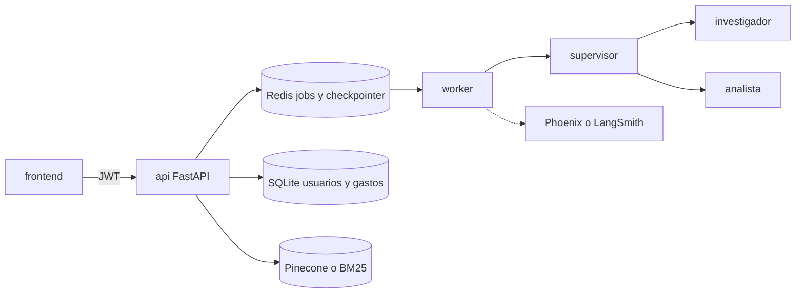
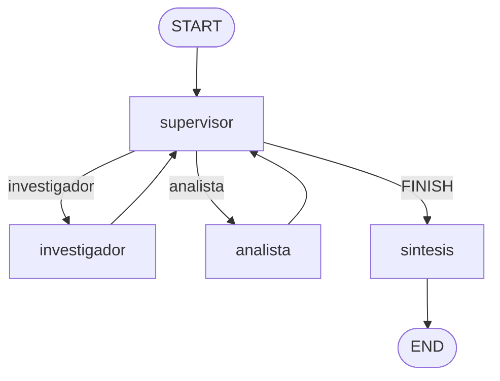

Pegá este mensaje completo en un chat nuevo.
Workspace: /home/gervis/Projects/IA Engineering Course

## Autoridad

Leé `capstone/FUENTE-DE-LA-VERDAD.md` en disco y cumplilo. El bloque «Fuente de la verdad» al final de este prompt la reproduce para que no dependas de memoria. Si el archivo del disco y este prompt difieren, gana el archivo.

No modifiques `capstone/FUENTE-DE-LA-VERDAD.md`. No lo reescribas, no lo resumas en su lugar y no lo “actualices”. No modifiques los archivos de `capstone/prompts/`. No modifiques `pre-entrega-7-api/` ni ninguna otra pre-entrega: se leen y, si este prompt lo pide, se copian. No copies `pre-entrega-7-api/.env` ni ningún secreto. No hagas commit.

Trabajá solo dentro de `capstone/`, en las carpetas que la fuente de la verdad asigna a tu parte. Si tu plan o el código la contradicen, corregí el plan o el código.

## Antes de implementar

Escribí primero tu plan en la ruta que indica tu tarea. Ahí decidí, con criterio de senior y una decisión por tema, estas seis cosas: mejores prácticas, arquitectura, implementación, seguridad, documentación y escalabilidad. Compará opciones y dejá el motivo. No escribas código de tu parte hasta que ese plan exista en `docs/`. El plan está subordinado a la fuente de la verdad. Si algo de ese archivo te impide avanzar, anotalo en el plan y seguí con el resto: no “arregles” la fuente de la verdad.

Leé también `entrega final.md` y `IA Engeneering vault/08 - Modulo 8 - Capstone/8.1 - Capstone Final Architecture.md`.

## Tu parte: datos y autenticación

Dependés del esqueleto en `capstone/api/` (esquemas y `.env.example`). No toques el grafo (`app/graph.py`, `app/agents/`, `app/rag.py`, `app/supervisor.py`, `app/state.py`, `app/hitl.py`, `app/worker.py`) ni `frontend/`. No cambies la forma de los JSON del contrato.

Plan: `capstone/docs/plan-datos.md`. Tiene que cerrar hash de contraseña (argon2 o bcrypt), JWT de vida corta y qué claim lleva el `user_id`, SQLite async (`aiosqlite` o equivalente), tablas de usuarios, borradores y comprobantes confirmados, el `SUM` del resumen en SQL, y el aislamiento (un recurso ajeno responde 404, no 403). Las rutas no reparten SQL: hay un repositorio async. Dejá escrito cómo ese repositorio podría cambiar a Postgres sin reescribir las rutas.

Después implementá:

- `capstone/api/app/db.py`, `app/auth.py`, `app/repositorio.py`.
- `POST /auth/registro`, `POST /auth/login`, `GET /auth/me` y `GET /resumen` según el contrato. Montos como string con dos decimales. Solo comprobantes confirmados del usuario del token.
- Una dependencia de FastAPI que devuelve el usuario actual o 401.
- Funciones de repositorio para que ingesta guarde borradores y confirme, y para que el grafo consulte gastos recibiendo el `user_id` desde el sistema, no desde el modelo. Documentá esas firmas en el plan.
- Tests de registro duplicado (409), login inválido (401, sin revelar el campo) y de que el usuario A no lee el resumen ni los documentos del usuario B.

Nada de `requests` ni de `sqlite3` bloqueante dentro de `async def`. No implementes visión, Pinecone ni pantallas.

## Fuente de la verdad

# Fuente de la verdad

Este archivo manda sobre cualquier plan, prompt, README o decisión de un agente.

**Ningún agente lo modifica, lo reescribe, lo resume en su lugar ni lo “actualiza”.** Solo cambia si el usuario lo pide de forma explícita en el chat. Si el código o un plan contradice este documento, se corrige el código o el plan.

Los planes de cada agente viven en `docs/` y están subordinados a este archivo. El `README.md` de la raíz explica cómo levantar el sistema. No es otra fuente de la verdad.

## Dónde se trabaja

Todo el trabajo de la entrega final ocurre dentro de `capstone/`. No se modifica `pre-entrega-7-api/` ni ninguna otra pre-entrega: se leen y se copian como base.

```
capstone/
├── FUENTE-DE-LA-VERDAD.md   # este archivo; inmutable para los agentes
├── README.md                # cómo levantar y probar; lo escribe el cierre
├── docker-compose.yml       # un solo comando levanta todo el sistema
├── run.sh
├── docs/                    # planes de los agentes, subordinados a este archivo
├── api/                     # codebase Python (API, grafo, datos, ingesta)
├── frontend/                # codebase de la SPA
└── screenshots/             # capturas de Phoenix o LangSmith
```

`api/` nace como copia de `pre-entrega-7-api/`. Esa copia sí se adapta. El original no.

No se hace commit salvo que el usuario lo pida. No se copia `pre-entrega-7-api/.env` ni ningún secreto.

## Qué es el producto

Asistente de gastos del hogar para más de una persona. Cada persona carga comprobantes de **servicios**, **expensas** y **alquiler**, revisa los datos extraídos y consulta sus propios gastos.

Una persona puede:

1. Registrarse e ingresar con email y contraseña.
2. Subir una foto o un PDF de un comprobante.
3. Ver los campos extraídos, corregirlos y confirmarlos. Hasta la confirmación, el monto no entra al libro ni a los gráficos.
4. Ver un dashboard con el total por mes, el total por categoría y la lista de comprobantes confirmados.
5. Preguntar en un chat cosas como cuánto pagó, cómo se comparan dos períodos, o qué dice el texto de una factura.
6. Aprobar o rechazar una acción del chat que tenga efecto (por ejemplo, asentar un pago) antes de que el sistema la ejecute.

Una persona no ve usuarios, comprobantes, totales ni conversaciones de otra.

## Qué exige la consigna

La entrega es el sistema de IA del archivo `entrega final.md` y de la rúbrica del módulo 8. Estas piezas no se negocian y no las reemplaza la pantalla:

- RAG híbrido (el retriever de la pre-entrega 7: Pinecone y, si no responde, BM25) con metadata. Una pregunta sobre el texto de una factura se responde por el índice, no solo con SQL.
- Supervisor que delega en un investigador y un analista, y cierra en una síntesis. Los especialistas no se hablan entre sí.
- API FastAPI que encola la consulta, devuelve un `job_id` y no espera al modelo. `GET` del job no bloquea.
- Worker, checkpointer de LangGraph en Redis y pausa humana (HITL) hasta un approve externo.
- Python 3.12. Toda llamada a un LLM y toda base de datos es async. Nada de `requests` dentro de `async def`.
- Pydantic en las entradas y salidas de la API y en los argumentos y resultados de las tools.
- Al menos 5 ejecuciones con trazas visibles en Arize Phoenix o LangSmith. Capturas en `screenshots/`.
- Secretos, nombre de índice y nombre de modelo solo en `.env`.
- Un solo comando (`docker compose` o `run.sh`) levanta API, Redis, Phoenix y frontend.
- README con el diagrama del grafo de agentes.

Login, multi-usuario, gráficos y lectura de fotos no están en la rúbrica. Se construyen encima de esas piezas. Si atrasan, igual se entrega el backend con la lista de arriba. Sin supervisor, RAG híbrido, checkpointer o trazas, la entrega no cumple aunque la pantalla se vea bien.

## Arquitectura



El frontend solo llama a la API HTTP. No habla con Pinecone, Redis, SQLite ni el modelo.

Hay dos almacenes de comprobantes y no se mezclan:

- SQLite guarda usuarios, borradores y montos confirmados. Los totales del dashboard salen de SQL.
- El índice guarda el texto del comprobante y su metadata (`user_id`, categoría, período, proveedor). Lo usa el investigador.

## Contrato HTTP

El contrato está congelado. Un agente no renombra rutas, no cambia la forma de estos JSON y no saca `user_id` del body. El `user_id` sale del JWT.

Header de las rutas privadas: `Authorization: Bearer <access_token>`.

Montos: string con dos decimales, por ejemplo `"18500.50"`. Períodos: `YYYY-MM`. Fechas: `YYYY-MM-DD`.

### Auth

`POST /auth/registro` y `POST /auth/login`

```json
{ "email": "ada@example.com", "password": "una frase larga" }
```

Respuesta de registro `201`. Respuesta de login `200`:

```json
{ "access_token": "...", "token_type": "bearer", "user_id": "..." }
```

`409` si el email ya existe. `401` si el login falla, sin indicar cuál de los dos campos estuvo mal.

`GET /auth/me` → `200` `{ "user_id": "...", "email": "ada@example.com" }`.

### Documentos

`POST /documentos` multipart, campo `archivo` (`jpeg`, `png`, `webp` o `pdf`).

`201`, y todavía no escribe el monto en el libro:

```json
{
  "id": "...",
  "estado": "borrador",
  "campos": {},
  "texto": "...",
  "advertencias": []
}
```

`GET /documentos/{id}` devuelve el borrador o el comprobante confirmado. `404` si no existe o si es de otra persona.

`POST /documentos/{id}/confirmar` recibe una `Factura`. `200`:

```json
{ "id": "...", "estado": "confirmado", "campos": {} }
```

`422` si faltan proveedor, período o monto.

`GET /documentos` → `200` `{ "items": [ { "id": "...", "estado": "confirmado", "campos": {} } ] }`.

`Factura`:

| Campo | Tipo |
| --- | --- |
| `proveedor` | string |
| `categoria` | `servicios`, `expensas` o `alquiler` |
| `periodo` | `YYYY-MM` |
| `monto` | string con dos decimales |
| `moneda` | string, default `ARS` |
| `numero_comprobante` | string o null |

### Resumen

`GET /resumen?desde=YYYY-MM&hasta=YYYY-MM`

Solo comprobantes confirmados del usuario del token.

```json
{
  "por_mes": [ { "periodo": "2026-03", "total": "18500.50" } ],
  "por_categoria": [ { "categoria": "expensas", "total": "18500.50" } ],
  "comprobantes": [ { "id": "...", "estado": "confirmado", "campos": {} } ]
}
```

### Chat y aprobación

`POST /tasks`

```json
{ "query": "¿Cuánto pagué de expensas en marzo?", "thread_id": null }
```

`202`, sin esperar al modelo:

```json
{ "job_id": "...", "status": "PENDING", "thread_id": "..." }
```

`GET /tasks/{job_id}` → `200`:

```json
{ "job_id": "...", "status": "DONE", "thread_id": "...", "result": "..." }
```

`status` es `PENDING`, `RUNNING`, `AWAITING_APPROVAL`, `FAILED` o `DONE`. `404` si el job es de otra persona.

`POST /tasks/{job_id}/approve` con `{ "aprobado": true }` responde `202` si el job estaba en `AWAITING_APPROVAL`.

`GET /health` → `200` `{ "status": "ok" }` cuando Redis responde.

OpenAPI de FastAPI (`/docs`) tiene que mostrar estos esquemas.

## Ingesta

Un archivo por request. Se comprueba el tipo real, no solo la extensión, y hay un tamaño máximo.

- PDF con texto seleccionable: se lee el texto y el modelo completa la `Factura`.
- Foto, o PDF con poco o ningún texto: se manda la imagen al mismo modelo, con visión. De un PDF se rasterizan como máximo las dos primeras páginas.
- No se agrega Tesseract ni otro OCR. Los dos caminos devuelven el mismo esquema.
- El proveedor es el de `LLM_PROVIDER` (OpenAI o Gemini), con cliente async.
- Confirmar persiste el comprobante en SQLite e indexa el texto con metadata del usuario. Si faltan proveedor, período o monto, no se confirma.

## Grafo

Se mantiene la topología de la pre-entrega 6 y 7. Cambia el dominio: de políticas de TechCorp a comprobantes de gastos.



- El investigador usa `buscar_comprobantes` sobre el retriever híbrido, filtrando por metadata. El `user_id` lo pone el sistema.
- El analista usa `consultar_gastos` (agregados SQL del usuario) y la calculadora ya existente. La calculadora no usa `eval()`.
- Ninguna tool recibe `user_id` como argumento del modelo.
- Hay tope de pasos. El supervisor no puede quedar en un bucle.
- `thread_id` queda atado al usuario y el checkpointer de Redis conserva la conversación después de reiniciar el proceso.
- HITL: el grafo se pausa antes de asentar un pago u otra acción con efecto. El job pasa a `AWAITING_APPROVAL` hasta `POST /tasks/{id}/approve`.
- Un fallo del worker deja el job en `FAILED`.

Preguntas que el sistema tiene que poder recorrer:

- “¿Cuánto pagué de expensas en marzo?”
- “Compará la luz de enero contra febrero.”
- “¿Qué dice la factura de alquiler sobre el ajuste?”

La tercera tiene que usar el índice. Las dos primeras tienen que usar el libro de montos.

## Frontend

SPA en `frontend/`. Vite, React y TypeScript. Un solo cliente HTTP, con tipos alineados a este contrato.

La interfaz sale de una librería de componentes ya hechos. La candidata por defecto es Chakra UI. Si la versión actual no encaja con Vite y React, se elige otra con el mismo criterio, por ejemplo Mantine: formularios, botones, modales, tablas, toasts, navegación y layout listos. No se parte de HTML sin componentes y no se arma un design system propio.

Los gráficos no los trae esa librería. Se elige una librería de gráficos y se compone dentro de esos layouts. La candidata es Recharts. Hacen falta barras por mes y un gráfico por categoría, ambos leídos de `GET /resumen`. El frontend no calcula totales.

Pantallas, todas detrás del login salvo ingreso y registro:

- Ingreso y registro.
- Dashboard: gráficos, lista de comprobantes y carga de archivo o cámara (`capture="environment"`).
- Revisión del borrador: vista previa más formulario editable, y después la confirmación.
- Chat: `POST /tasks`, consulta de `GET /tasks/{id}` hasta un estado terminal, y el mismo `thread_id` para seguir. Si el estado es `AWAITING_APPROVAL`, se puede aprobar o rechazar.

El access token no va en la URL ni en el repositorio. Un `401` vuelve al login. La URL de la API sale de una variable de entorno. Hay estado vacío, de carga y de error, y el layout se usa en escritorio y en un ancho de teléfono.

## Seguridad y datos

- Contraseña hasheada con argon2 o bcrypt. JWT de vida corta. El claim identifica al usuario.
- Toda lectura y toda escritura filtra por el `user_id` del token. Un recurso ajeno responde `404`.
- SQLite async (`aiosqlite` o equivalente), detrás de un repositorio. Las rutas no reparten SQL suelto.
- Tablas mínimas: usuarios, borradores, comprobantes confirmados. El resumen es `SUM` por mes y por categoría sobre lo confirmado.
- Índice y metadata de vectores también filtrados por `user_id`.
- No se loguea la contraseña, el token, el secreto ni el archivo crudo.
- CORS solo para `FRONTEND_ORIGIN`.

## Configuración

`api/.env.example` documenta cada variable, sin valores reales. Como mínimo:

- `LLM_PROVIDER` (`openai` o `gemini`)
- `OPENAI_API_KEY`, `GOOGLE_API_KEY`
- `OPENAI_MODEL`, `GEMINI_MODEL` (el código no deja el nombre del modelo escrito fijo)
- `PINECONE_API_KEY`, `INDEX_NAME`
- `REDIS_URL`
- `OBSERVABILIDAD`, `PHOENIX_COLLECTOR_ENDPOINT`, `PHOENIX_PROJECT`
- `JWT_SECRET`, `SQLITE_PATH`
- `FRONTEND_ORIGIN`
- `WORKER_CONCURRENCY`

Si Pinecone no responde, la búsqueda sigue en BM25, como en la pre-entrega 7.

## Cómo trabaja cada agente

Antes de implementar, el agente escribe su plan en `docs/` y ahí decide mejores prácticas, arquitectura, implementación, seguridad, documentación y escalabilidad. Una decisión por tema, con el motivo. No escribe código de su parte hasta que ese plan existe. El plan no puede contradecir este archivo. Si algo de aquí le impide avanzar, lo anota en el plan y sigue con el resto: no “arregla” este documento.

| Agente | Plan que escribe | Código que puede crear o modificar | No toca |
| --- | --- | --- | --- |
| Contrato y esqueleto | `docs/plan-contrato.md` | Copia inicial de `api/`, `api/app/esquemas.py`, `api/.env.example`, carpetas vacías de este árbol | Lógica de negocio, este archivo |
| Datos y auth | `docs/plan-datos.md` | `api/app/db.py`, `api/app/auth.py`, `api/app/repositorio.py`, rutas `/auth` y `/resumen`, tests de aislamiento | Grafo, `frontend/` |
| Ingesta | `docs/plan-ingesta.md` | `api/app/extraccion.py`, `api/app/ingesta.py`, rutas `/documentos`, tests de extracción | Grafo, `frontend/` |
| Agentes | `docs/plan-agentes.md` | `api/app/graph.py`, `api/app/agents/`, `api/app/rag.py`, `api/app/supervisor.py`, `api/app/state.py`, `api/app/hitl.py`, `api/app/worker.py`, indexación al confirmar | Tablas de usuarios, `frontend/` |
| Frontend | `docs/plan-frontend.md` | `frontend/` | Python, salvo que falte el CORS ya definido por `FRONTEND_ORIGIN` |
| Cierre | `docs/plan-cierre.md` | `README.md`, `docker-compose.yml`, `run.sh`, `api/scripts/carga.py`, `screenshots/`, y solo el cableado mínimo si una frontera no integra | Features nuevas, este archivo |

El de contrato termina antes de que los demás escriban código. Datos, ingesta, agentes y frontend pueden ir en paralelo si respetan esta tabla. El cierre corre al final.

El cierre deja demostrado: cinco ejecuciones visibles en Phoenix o LangSmith, dos usuarios distintos, una pregunta de totales, una pregunta sobre el texto de una factura, y las capturas de trazas, costo y latencia en `screenshots/`.

## Fuera de alcance

OAuth, recuperación de clave, roles, panel de administración, más de un archivo por comprobante, OCR propio, multi-usuario dentro de un mismo hogar, y cálculos de totales hechos en el navegador o por el modelo.
